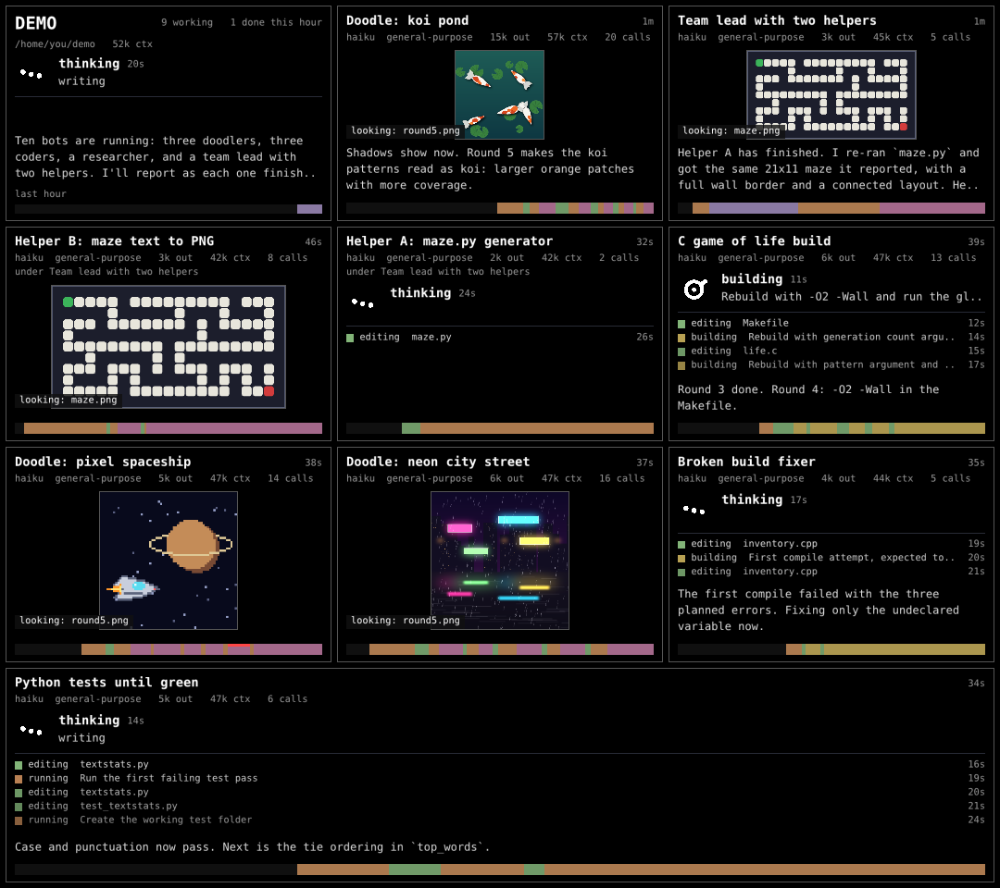
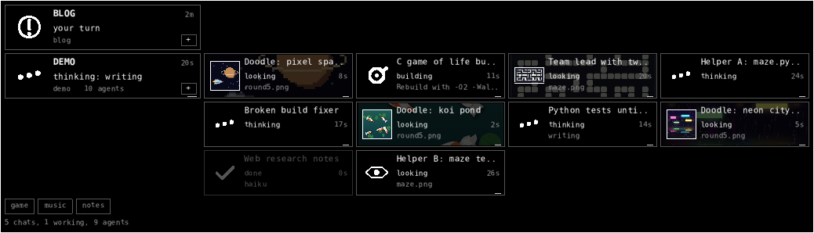
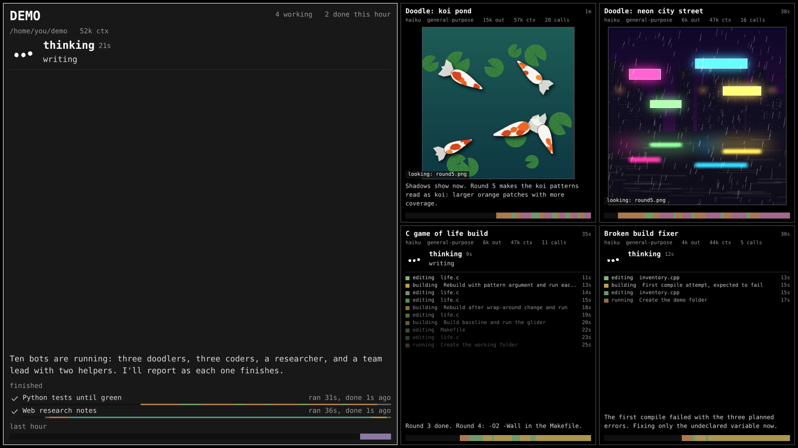

# productmanager

A heads-up display for AI coding agents. It watches every running Claude Code
and Codex chat and the subagents each one launches, and shows what each is doing right
now: reading, searching, editing, building, running, looking at an image,
waiting on you. It does nothing itself and costs no tokens. It only reads the
logs the agents already write.

There are two kinds of window.

**The strip** is one small floating window for the whole desktop. Each working
chat gets a tile, its agents get small tiles beside it, and quiet chats shrink
to name chips. A chat whose turn just ended pulses white: it is waiting on you.
Click a chat to jump to its terminal.

**Viewers** are big normal windows, as many as you like, usually one per
workspace next to the chat it watches. A viewer fills itself with tiles: the
chat's leader and one tile per working agent. With a few agents the leader is
the big master tile and the agents share the rest; past that it is a grid.

Each agent tile shows:

- what it is doing now, in large text, with how long it has been at it
- the calls before that, newest first
- the last thing it said
- its model, tokens written, context size and number of calls
- its whole life as a colored barcode: one stripe per tool call, red marks for
  failed calls
- the image it is looking at, filling the tile for 40 seconds
- "under <parent>" when another agent launched it

A tile turns amber when an agent fails three calls in a row, goes quiet for
five minutes, or edits the same file as another agent. The leader tile lists
the agents that finished in the last hour.

## Use

    productmanager            show the strip, or hide it when it is showing
    productmanager start      show the strip unless it already runs (for login)
    productmanager stop       close the strip and every viewer
    productmanager big        open a viewer for the chats on this workspace
    productmanager big NAME   open a viewer for one chat

`pm` is the same program under a short name. On the strip, each working chat
has a small `+` button that opens a viewer for it (the viewer moves itself to
the workspace where that chat's terminal is) and turns into `x` to close it.
Clicking a tile in a viewer jumps to that chat.

## Build and install

Linux and X11. Needs CMake 3.25+, a C++20 compiler and Ninja. SDL 3.4 is used
if installed, otherwise CMake fetches it and links it statically.

    cmake -S . -B build -G Ninja -DCMAKE_BUILD_TYPE=Release
    cmake --build build
    cmake --install build --prefix ~/.local

That installs `productmanager`, the `pm` link, and the fonts under
`~/.local/share/productmanager`.

Jumping to a chat uses `tmux` (when the chat runs in tmux), `xdotool` and
`i3-msg`. Under i3, these rules make the strip float on every workspace and
let viewers tile, without either taking focus when they open:

    for_window [class="^productmanager$" title="^productmanager$"] floating enable, sticky enable, border none
    no_focus [class="^productmanager$"]

To start the strip on login, put `productmanager start` in your session
autostart.

## How it reads Claude Code

- `~/.claude/sessions/<pid>.json`: one per running chat, with its name, whether
  it is busy, its working directory and its session id.
- `~/.claude/projects/<folder>/<session>.jsonl`: the chat's log. The last tool
  call picks the tile's icon and text.
- `<session>/subagents/agent-*.jsonl` and `.meta.json`: one per agent, with its
  description, model, parent and whether it finished.

It checks the session files once a second and reads only what was appended to
each log, four times a second. Everything it reads is already in the page
cache, and it writes nothing to disk; viewers register themselves in
`$XDG_RUNTIME_DIR/productmanager`.

## How it reads Codex

- `~/.codex/sessions/YYYY/MM/DD/rollout-*.jsonl`: one log per thread, written
  live. Its first line names the thread's folder, and for a subagent, its
  parent thread, nickname and task. Subagents become agent tiles under their
  parent.
- `~/.codex/session_index.jsonl`: thread titles, used as the chat's name.
- `~/.codex/generated_images/<thread>/`: images Codex generates, shown on the
  tile that made them.

Codex keeps no "this chat is running" file, so a thread counts as live while
a `codex` process runs in its folder (which is also how clicking jumps to its
terminal), or while its log was written in the last half hour. A thread is
working while its turn is open, and waiting on you once its task completes.

Other agents (Antigravity, Hermes and more) are planned; see
[docs/todo.md](docs/todo.md).

## Check the look without a display

    env -u DISPLAY SDL_VIDEO_DRIVER=offscreen SDL_RENDER_DRIVER=software \
        ./build/productmanager --shot strip.png
    xvfb-run -a -s "-screen 0 1920x1200x24" \
        ./build/productmanager --view --pin NAME --size 1600x900 --shot viewer.png

## Credits

Fonts: DejaVu Sans Mono (see `assets/LICENSE-DejaVu.txt`). Vendored single
headers: stb_truetype, stb_image and stb_image_write by Sean Barrett, and
nlohmann/json.
